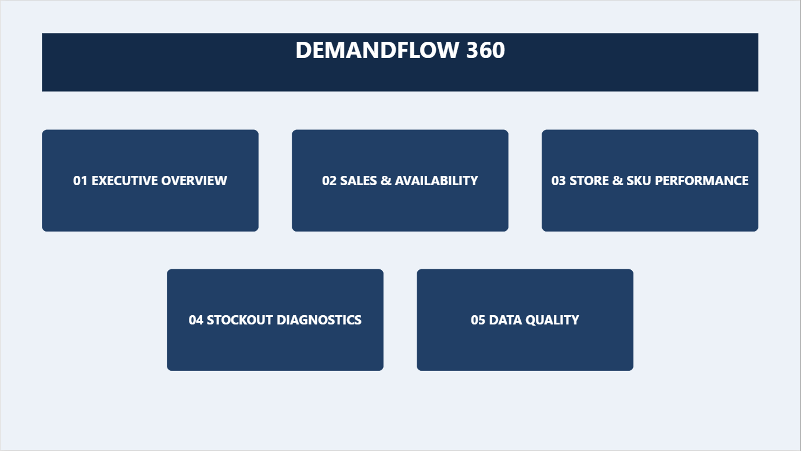
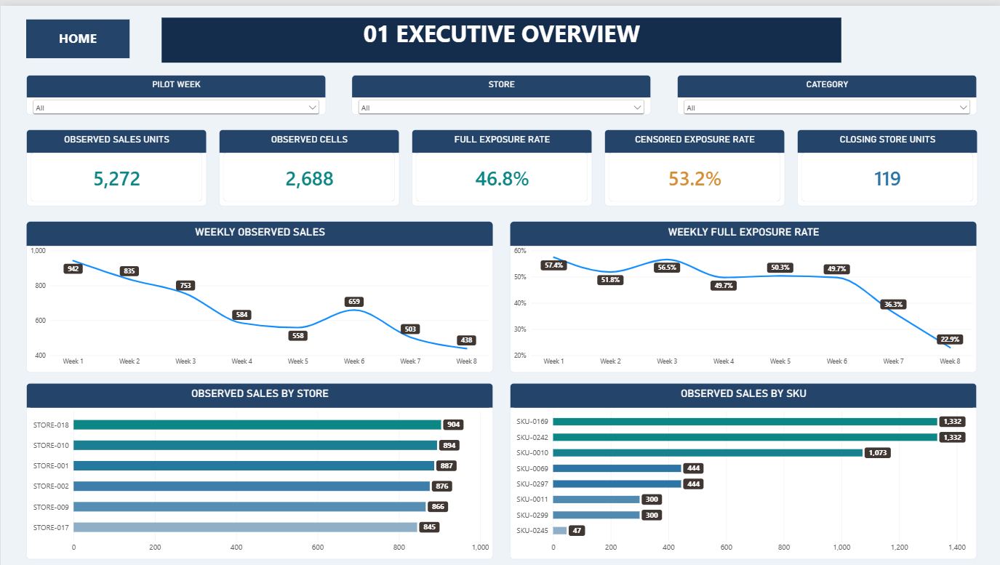
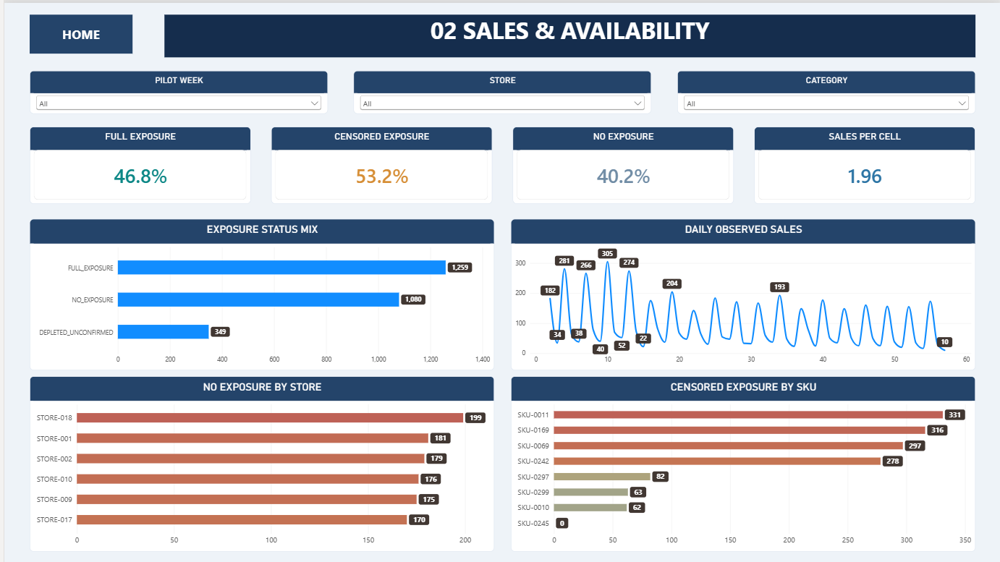
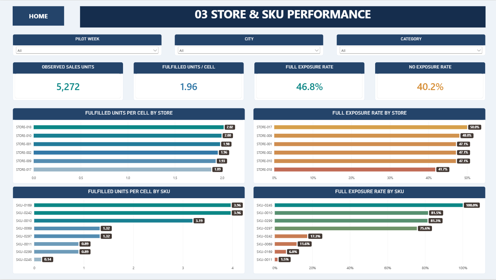
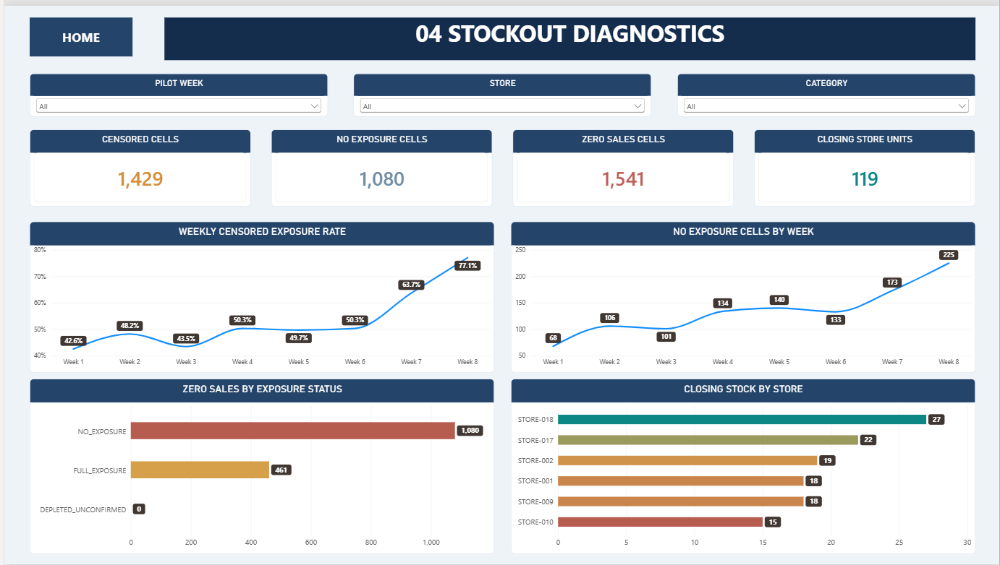
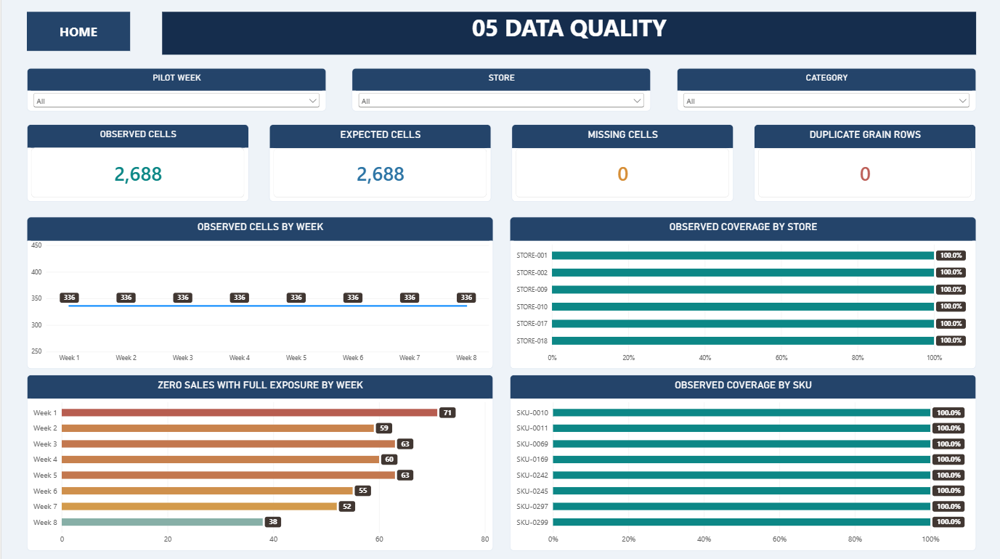
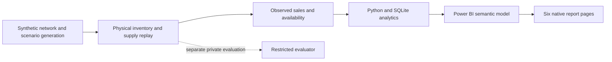

# DemandFlow 360

**Retail Demand & Supply Chain Analytics · Native Power BI Portfolio**

[](https://github.com/khaledzidan203-stack/demandflow-360/actions/workflows/qa.yml)
[](https://www.python.org/)
[](powerbi/DemandFlow%20360.pbip)
[](docs/LIMITATIONS.md)

> **Release:** [v0.1.0-descriptive-pilot](https://github.com/khaledzidan203-stack/demandflow-360/releases/tag/v0.1.0-descriptive-pilot) · **56-day synthetic descriptive pilot — NOT TRAINING APPROVED.**

Retail sales tell us what was fulfilled, not everything customers wanted to buy.
DemandFlow 360 connects a separately developed physical supply-chain simulation
framework to an observed-only analytical dataset, independently reconciled Python
and SQLite analysis, and a native, editable six-page Power BI report.

This repository is complete for the public descriptive layer: frozen public inputs,
reproducible analysis, validated semantic definitions, a portable launcher and tests.
It does not ship the restricted evaluator, the development archive or a completed
forecasting/optimization application.

**Explore:** [Dashboard gallery](#dashboard-gallery) · [Open in Power BI](#open-in-power-bi) · [Business case](#business-questions) · [Reproduce & test](#reproduce-and-test) · [QA evidence](#qa-and-release-status)

---

## Project at a glance

| Pilot window | Network | Observed data | Interactive report |
|:--|:--|:--|:--|
| **56 simulated days** | **6 stores · 8 SKUs** | **2,688 cells · 5,272 fulfilled units** | **6 native Power BI pages** |

The analytical scope is intentionally bounded. Observed fulfilled sales are **not** unconstrained demand; stock-related censoring affected **53.16%** of observed cells. The wider forecasting and inventory-optimization roadmap is not claimed as completed.

## Dashboard gallery

**Actual screenshots from the approved native Power BI report.** Click a screenshot to view it full size. These are historical owner-reviewed renderings, not newly captured clean-clone interaction tests.

<table>
 <tr>
  <td align="center" valign="top" width="50%">
    <a href="screenshots/00_index.png"></a>
    <p><strong>00 · INDEX</strong><br>Navigation across five analytical pages</p>
  </td>
  <td align="center" valign="top" width="50%">
    <a href="screenshots/01_executive_overview.png"></a>
    <p><strong>01 · Executive Overview</strong><br>Fulfillment, exposure and performance trends</p>
  </td>
 </tr>
 <tr>
  <td align="center" valign="top" width="50%">
    <a href="screenshots/02_sales_availability.png"></a>
    <p><strong>02 · Sales & Availability</strong><br>Daily sales and availability patterns</p>
  </td>
  <td align="center" valign="top" width="50%">
    <a href="screenshots/03_store_sku_performance.png"></a>
    <p><strong>03 · Store & SKU Performance</strong><br>Fulfilled units per cell and full exposure</p>
  </td>
 </tr>
 <tr>
  <td align="center" valign="top" width="50%">
    <a href="screenshots/04_stockout_diagnostics.png"></a>
    <p><strong>04 · Stockout Diagnostics</strong><br>Censoring, zero sales and stock snapshots</p>
  </td>
  <td align="center" valign="top" width="50%">
    <a href="screenshots/05_data_quality.png"></a>
    <p><strong>05 · Data Quality</strong><br>Coverage, missingness and duplicates</p>
  </td>
 </tr>
</table>

## Open in Power BI

Requirements: Windows, current Microsoft Power BI Desktop with PBIP support,
and Python 3.11 or newer. No Python third-party libraries, database server or
DAX Studio installation are required for ordinary use.

1. Clone this repository or download and extract the **entire** repository ZIP.
2. Double-click **Launch_DemandFlow360.cmd**, or run:

```powershell
python launch_powerbi.py
```

3. In Power BI Desktop, select **Home > Refresh** and wait for completion.
4. Use INDEX navigation and HOME buttons (Ctrl+click in Desktop edit mode).
   Pilot week, store/city and category slicers filter the native visuals.

The launcher validates CSV fingerprints/schema/keys and the native file inventory,
then prepares an ignored `.runtime/session_.../powerbi` project with a machine-local
DataRoot. It discovers its own checkout location, including spaces and Unicode;
it does not edit the committed report. Each launch creates a fresh session so it
cannot overwrite an already opened project. Runtime copies are disposable local
work; edits made inside one are not changes to the canonical project.

Do not open the canonical PBIP directly: its deliberate DataRoot placeholder
must be configured by the launcher. See [Power BI guide](docs/POWER_BI_GUIDE.md).

## Business questions

- How do fulfilled sales and observed availability vary across the pilot?
- Which stores and SKUs differ in sales and exposure?
- Which zero-sales observations had full exposure, and which were censored?
- Are analytical coverage, grain and cross-tool totals consistent?

Future work concerns leakage-safe rolling forecasts and constrained inventory
experiments. Forecast accuracy, ROI and optimization savings are not release findings.

## Architecture



The published boundary begins at observed CSVs. Private simulation inputs and
outcomes are excluded. See [architecture](docs/ARCHITECTURE.md).

## Scope and findings

One run/scenario/policy; days **2–57**, **6 stores**, **8 durable SKUs**.
One fact row is run × scenario × policy × day × store × SKU.
Day indices and seven-day pilot blocks are preserved; no calendar dates or prices
have been invented.

| Metric | Reconciled result |
|---|---:|
| Observed cells / expected cells | 2,688 / 2,688 |
| Fulfilled sales units | 5,272 |
| Full-exposure cells | 1,259 (46.84%) |
| Censored cells | 1,429 (53.16%) |
| No-exposure cells | 1,080 |
| Zero-sales cells | 1,541 |
| Zero sales with full exposure | 461 |
| Day-57 closing store stock | 119 units |

Week 1 sales were 942 units versus 438 in week 8, while full exposure fell from
57.44% to 22.92%. This does **not** establish a decline in underlying demand.
STORE-018 fulfilled 904 units; SKU-0245 fulfilled 47 with full exposure in all its
336 cells. Availability changes how these rankings should be interpreted.
See the [case study](docs/CASE_STUDY.md) and [data dictionary](docs/DATA_MODEL.md).

## Reproduce and test

From the checkout root (Python/SQL QA also runs on Linux):

```powershell
python -m pip install -r requirements.txt
python tools/reproduce.py
python -m unittest discover -s tests -v
python tools/release_qa.py
python launch_powerbi.py --prepare-only
```

The first command has no third-party packages to install. Reproduction creates
an ignored, fresh `outputs/analysis_...` directory with SQLite, grouped CSVs and
QA totals. The original CSVs remain unchanged. Six grouping levels reconcile
145 output rows independently in Python and SQLite, with total and filter-context
checks. [SQL queries](sql/business_queries.sql) are reusable against the generated
database. See [reproducibility](docs/REPRODUCIBILITY.md).

## Repository map

```text
demandflow-360/
├── data/powerbi/            # Four observed-only CSV tables
├── powerbi/                 # Editable .pbip, PBIR pages and TMDL model
├── screenshots/             # Six genuine Power BI screenshots
├── sql/                     # Analytical SQL views
├── tools/                   # Reproducible analysis and QA
├── tests/                   # Automated release tests
├── docs/                    # Case study, definitions, QA and limitations
├── .github/workflows/       # Cross-platform validation
├── launch_powerbi.py        # Portable Python entry point
└── Launch_DemandFlow360.cmd # Windows double-click launcher
```

**Further reading:** [Case study](docs/CASE_STUDY.md) · [Data model](docs/DATA_MODEL.md) · [KPI dictionary](docs/KPI_DICTIONARY.md) · [Reproducibility](docs/REPRODUCIBILITY.md) · [QA evidence](docs/QA_EVIDENCE.md) · [Limitations](docs/LIMITATIONS.md)

## QA and release status

The public workflow validates data hashes/schema/grain/FKs, observation accounting,
Python/SQL parity, six pages, 18 measures, three relationships, native field bindings,
navigation targets, screenshot links and publication safety. Launcher tests cover a
separate Unicode path with spaces, unrelated working directory, repeated preparation,
missing/corrupt files and canonical hash preservation. CI runs on Windows and Linux.

Release-time Windows Power BI engine checks are recorded in
[QA evidence](docs/QA_EVIDENCE.md). Static QA and CI do not replace interactive
Desktop Refresh, slicer and navigation acceptance. The owner previously reviewed
all six pages; new automated UI interaction remains **MANUAL_RUNTIME_QA_REQUIRED**.
See the repository Actions tab for the actual status of each commit; no CI success
is implied for future changes.

## Limitations and technology

Observed sales are not unconstrained demand. Censoring does not quantify unmet demand.
This is one finite synthetic world and policy, with 56 days and durable SKUs only.
Inventory snapshots are not additive over days. Complete coverage is not proof of
forecast-training suitability. No real revenue, dates, savings or production deployment
are claimed. [Full limitations](docs/LIMITATIONS.md).

Python standard library, SQLite, Power BI Desktop, Power Query M, TMDL, PBIR/DAX,
Git and GitHub Actions are used. DAX Studio is an optional release verification tool.
Original project code/data are offered under [MIT](LICENSE); Microsoft-generated
Power BI theme/schema assets retain their respective ownership.
